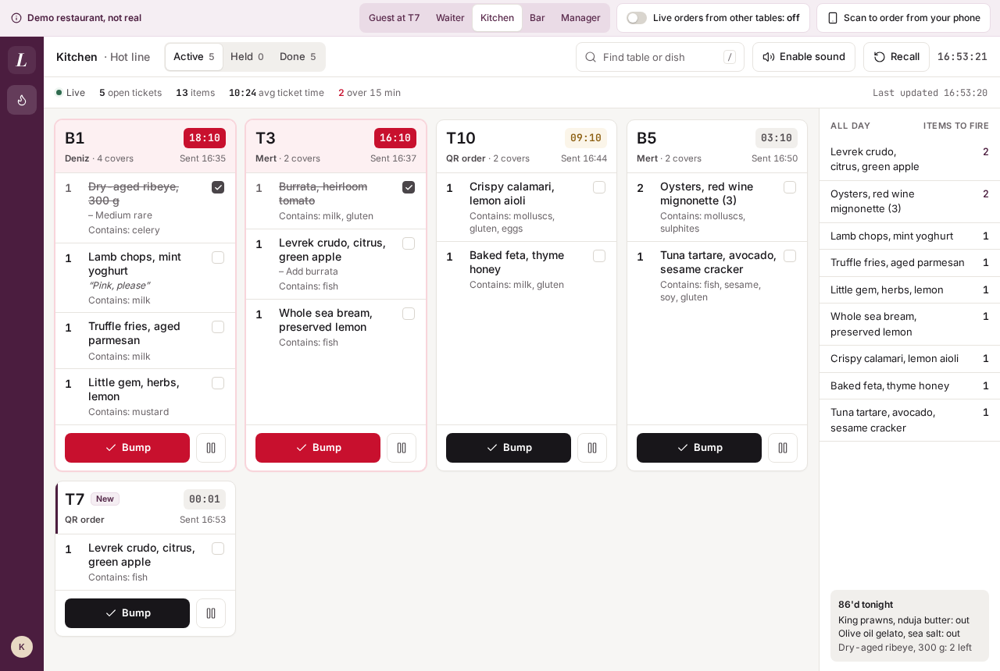
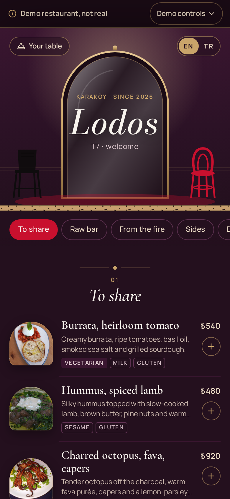
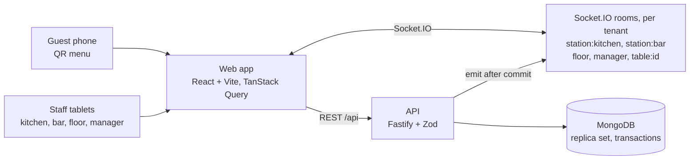
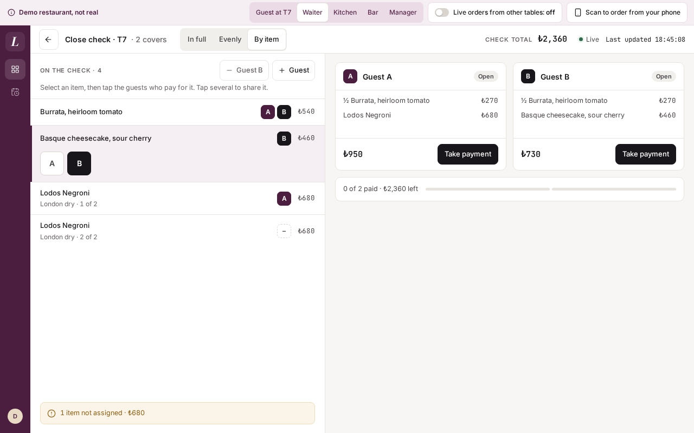
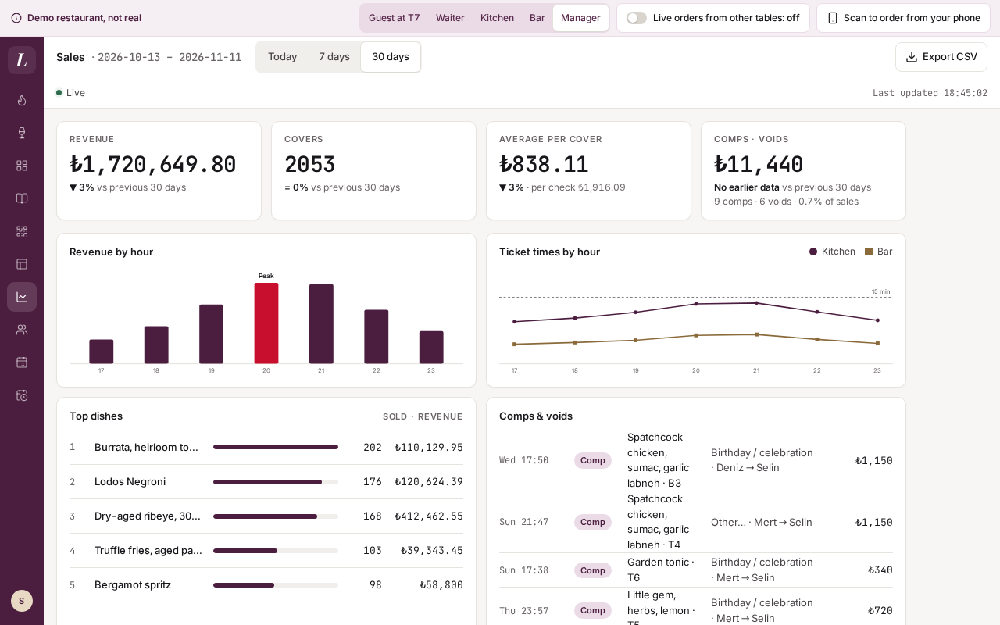
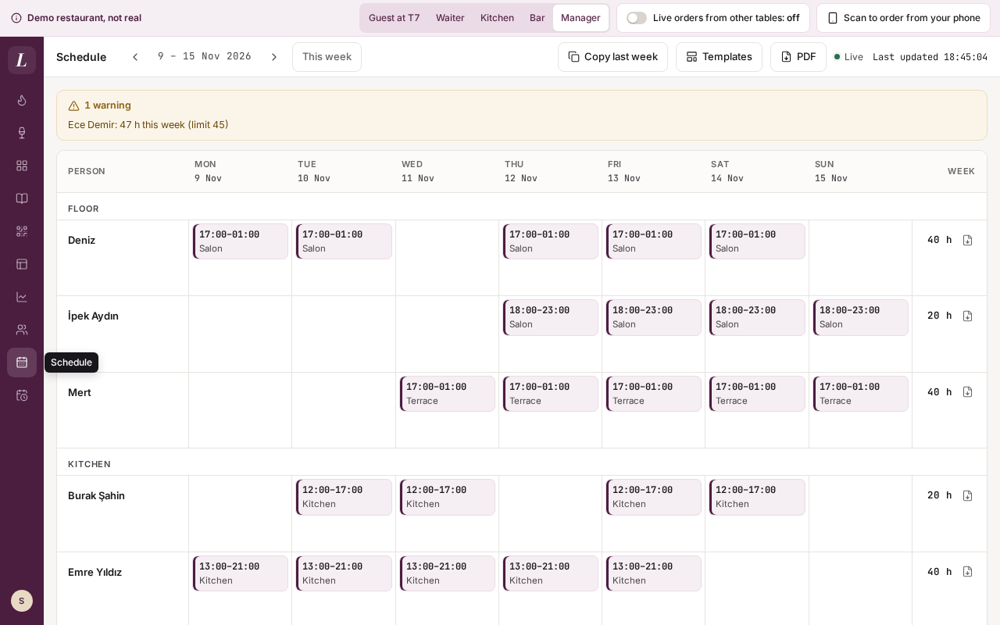

# Lodos: a real-time restaurant system

A restaurant system for a **fictional** bistro and cocktail bar in Karaköy, Istanbul, in English and Turkish. Guests order from a QR menu at their table, the kitchen and bar screens update the moment they do, waiters run the floor from a tablet, and the manager edits the menu and 86's dishes mid-service. It is a portfolio project by [Cem Akçiçek](https://github.com/cemakcck). "Lodos" (Istanbul's southwesterly wind) is an invented restaurant: every dish, table, staff name and order in the demo is made up, and the app says "Demo restaurant, not real" on every screen.

The point of the project is the part you can't see: **an order is never lost and never doubled**, whether the guest's phone drops mid-order, two guests race for the last portion, or a waiter closes the check while an order is in flight. See [How no order is ever missed](#how-no-order-is-ever-missed).

Deployment is coming; for now it runs locally (see [Running locally](#running-locally), and [Deploying](#deploying) for what a host needs).

<p>
  
  
</p>

## What you can do

- **As a guest:** scan the table's QR code, browse the menu (photos, allergens, dietary tags, the story behind a dish), choose options and extras, add a note for the kitchen and order. "Your table" shows every line live, from Sent to Preparing, Ready and Served. You can call the waiter or ask for the bill (card or cash). No account, no personal data.
- **As the kitchen or bar:** a live ticket board for your station only. Timers turn amber and then red, items tick off, tickets bump, hold and recall. "All day" counts what to fire, and the 86 list shows what is sold out or running low. A two-tone chime and a screen-reader announcement mark each new ticket.
- **As a waiter:** the floor plan with live table states (free, seated, food ready, calling, bill), an attention queue, and a table panel with the open check grouped as Food and Drinks. Seat a table, take an order on the tablet (everything goes straight to the kitchen and bar, no courses), mark food picked up, print and close the check (payment is simulated).
- **As the manager:** the menu editor (items, options, allergens, photos, station, price), one-tap 86 with an optional "N left" count, table names and QR codes (with a printable A4 sheet), and a "Tonight" summary.

### Try the magic moment

1. Open the demo and choose **Guest at T7**. Order the Levrek crudo and a Lodos Negroni.
2. A callout offers **"Now open the kitchen screen"** in a new window. Within a second your crudo is on the kitchen board, with a chime; the Negroni went to the bar instead.
3. Press **Bump**. Switch to **Waiter** in the demo banner: T7 is now "Food ready" on the floor plan, and the guest page says "Ready".

**Scan with your phone:** the demo banner has a **"Scan to order from your phone"** QR code. It carries your private copy of the restaurant and table T7, so you can order on your phone and watch it land on the kitchen screen on your laptop. (Your phone has to reach the laptop, so open the app at your computer's network address rather than `localhost`.)

Every visitor gets **their own private copy** of Lodos, seeded with a busy Friday service relative to the moment it is created: seated tables, tickets of different ages (two of them late), a table calling, one wanting the bill and a couple of 86'd dishes. A light simulator adds a believable QR order from another table every few minutes; the banner switches it off. Change anything you like: nobody else sees it, and the copy is deleted 30 minutes after your last window closes (or after 24 hours).

## How it works



- **A separate React frontend and API**, in one npm workspaces repo: `apps/web` (React, Vite, Tailwind, React Router, TanStack Query, an installable PWA), `apps/api` (Fastify, Zod, Mongoose, Socket.IO) and `packages/shared` (the Zod schemas, money and service-day helpers both sides use).
- **REST for commands and reads, Socket.IO for "something changed".** After each committed change the API emits a small event (`ticket.created`, `check.updated`, `availability.changed`, …) to the rooms that care. Clients refetch the affected queries. The server is the single source of truth and events never carry the only copy of anything.
- **Rooms per audience and per tenant.** Kitchen screens join `<tenant>:station:kitchen`, waiters `<tenant>:floor`, a guest only `<tenant>:table:<id>`. Guest sockets authenticate with the table's QR token, staff sockets with the session cookie.
- **Staff sign in by PIN** on a shared tablet (name tiles, then a 4 to 6 digit pad). PINs are hashed with argon2, wrong attempts lock the person for 5 minutes, and kitchen and bar wall screens use station accounts that never log out mid-service.
- **Times are Istanbul time** and the "service day" runs from 06:00 to 05:59, so a 01:00 order belongs to the previous evening. Money is integer kuruş, VAT included, formatted in one shared helper.

### Why MongoDB here

The records are naturally documents:

- **A menu item carries its option groups** ("Gin: London dry / Barrel-aged +₺90 / Mastic +₺60") nested inside it, in two languages.
- **An order is a snapshot.** Each line stores the dish name, price and chosen options as they were when ordered, so a later menu edit never changes a past check. In a relational schema that is a set of copy tables; here it is the order document.
- **Tickets, calls and checks are small documents** that change state quickly, and a single-node replica set gives multi-document transactions for the few writes that must be atomic.

## How no order is ever missed

### 1. Snapshot on every reconnect

Every screen fetches a full snapshot of what it shows on connect and on every reconnect, then applies events. A kitchen tablet that drops off the wifi shows "Offline / Reconnecting…" within a second (the socket follows the browser's offline and online events instead of waiting for a heartbeat), and the moment it is back it refetches and the missed tickets appear, with the chime. A browser that never fires "online" still reconnects: the socket retries within 10 seconds, and at once when the screen is shown or focused. As a last backstop, the kitchen board refetches every 30 seconds while its socket is down, and "Last updated" moves with every snapshot. The `kds-reconnect` end-to-end test takes the kitchen offline, places an order, checks it is absent while offline, and expects it on the board within 5 seconds of reconnecting, without a page reload.

### 2. Idempotency keys

Placing an order carries a client-generated idempotency key. A retry after a timeout reuses the key; any edit to the cart makes a new one. A unique index on `(tenantId, idempotencyKey)` means a repeated request returns the existing order instead of creating a second one, even when both copies arrive at the same moment (`orders.idempotency.test.ts`).

### 3. The last portion is atomic

"N left" lives in a per-service-day availability document. Placing an order decrements it with a conditional update inside the order's transaction, so the whole order (check, order, tickets, decrements) commits or nothing does. When two guests order the last ribeye at once, the second writer gets a write conflict, the transaction retries on a fresh snapshot, sees the dish sold out, and the guest gets a clear "just sold out" with the rest of their cart kept. `orders.race.test.ts` fires the two orders concurrently: exactly one 201, one `sold_out`, and the loser leaves no trace.

### 4. A closed check accepts no orders

An order writes the check it lands on (`$inc orderCount`, conditional on the check still being open). A waiter closing the check at the same moment writes the same document, so the two transactions conflict and one is retried. A retried guest order then finds the visit over: it either opens the next party's check or, if the guest's page still belongs to the old visit, gets `check_closed` and the page says "This table's visit has ended". The close in turn re-reads the lines when it retries, so the amount charged always includes every order that committed (`checks.test.ts`, including a free-running test of concurrent orders and closes).

## Multi-tenancy: a sandbox per visitor

Every document carries a `tenantId`: the visitor's sandbox in demo mode, or the real restaurant's when demo mode is off. Scoping is enforced in **one Mongoose plugin** ([`apps/api/src/db/tenancy.ts`](apps/api/src/db/tenancy.ts)), not per query by hand:

- A request runs inside `runWithTenant(id, …)` (AsyncLocalStorage). Every find, update, delete, aggregate, insert and bulk write on a scoped model is filtered by, or stamped with, that tenant.
- It **fails closed.** A query with no tenant context throws. Writing a different `tenantId` throws. Aggregation stages a filter can't scope (`$lookup`, `$unionWith`, `$out`) throw. The rare global lookup (a QR token, the sandbox registry) uses `unscoped(reason, …)` with the reason written at the call site.
- Socket rooms are namespaced per tenant too. The integration tests prove one sandbox can never read or change another's data, over HTTP (`isolation-http.test.ts`) or sockets (`isolation-socket.test.ts`).

Sandboxes are tied to the browser by a signed, httpOnly cookie, capped at 200 live copies (the oldest idle one goes first), rate-limited per IP, and cleaned up by a job every few minutes.

## Running locally

You need Node 22 and Docker (for MongoDB).

```bash
npm install
cp .env.example .env     # MongoDB on :27018, demo mode on, a dev-only session secret
npm run db:up            # MongoDB 8 as a single-node replica set (docker compose, or docker-compose)
npm run dev              # API on http://localhost:4100, web app on http://localhost:5180
```

Open <http://localhost:5180> and pick a role. To try the phone QR code, start the web app with `npm run dev -w @lodos/web -- --host`, open it at your computer's network address (for example `http://192.168.1.20:5180`) and set `WEB_ORIGIN` to that address.

**Demo mode or a real restaurant.** With `DEMO_MODE=1` every visitor gets a seeded sandbox and the banner's one-click roles; there are no PINs to know. With demo mode off, set up the restaurant from the command line instead (it refuses to run while `DEMO_MODE=1`):

```bash
npm run setup -w @lodos/api -- --tenant main --seed-menu \
  --staff "Selin:manager:482910" --staff "Deniz:waiter:1234" --staff "Kitchen:kitchen:5555" --staff "Bar:bar:6666"
```

`--seed-menu` loads the Lodos menu, rooms and tables without the demo's live service; `--staff "Name:role:PIN"` creates or updates a person (roles: manager, waiter, kitchen, bar).

### Environment variables

| Variable | Required | What it does |
| --- | --- | --- |
| `MONGODB_URI` | yes | MongoDB connection string. It must be a replica set (transactions) |
| `SESSION_SECRET` | yes | Signs session and sandbox cookies; at least 32 characters |
| `DEMO_MODE` | no | `1` turns on the demo: a sandbox per visitor, the banner, one-click roles, the simulator |
| `WEB_ORIGIN` | no | The web app's origin, for CORS (default `http://localhost:5180`) |
| `PORT`, `HOST` | no | Where the API listens (default `4100` on `0.0.0.0`) |
| `DEMO_SANDBOXES_PER_IP_HOUR` | no | New sandboxes allowed per IP per hour (default 5) |
| `TRUST_PROXY` | no | Behind a reverse proxy: `false` (default), `true`, a hop count, or a comma-separated list of proxy IPs / CIDRs. Per-IP limits then see the client's address |
| `COOKIE_SECURE` | no | `1` / `0`: session and sandbox cookies are HTTPS-only. Defaults to on when `NODE_ENV=production` |

**Storage caps.** Every restaurant (and every demo sandbox) holds at most 120 dishes and 20 MB of uploaded photos; past that, creating a dish or uploading a photo answers `409 limit_exceeded`. Replacing a photo frees the old one first. The caps are always on, not only in demo mode: a public demo visitor must not be able to fill the database, and a real menu never comes near them.

## Deploying

### Railway (one container)

The `Dockerfile` builds the web app and the API into one image, and the API serves the built app itself (`WEB_DIST`, set in the image), so `/api`, `/socket.io` and the pages share one origin with no proxy to configure. `railway.json` points Railway at the Dockerfile and health-checks `/api/health`.

1. Create a free MongoDB Atlas cluster (M0). Under Network Access allow `0.0.0.0/0` (Railway has no fixed outbound IP), create a database user, and copy the connection string with a database name, e.g. `mongodb+srv://lodos:<password>@cluster0.xxxxx.mongodb.net/lodos?retryWrites=true&w=majority`.
2. In Railway: New Project → Deploy from GitHub repo → this repo. Then Settings → Networking → Generate Domain.
3. Variables: `MONGODB_URI` (from step 1), `SESSION_SECRET` (`openssl rand -base64 48`), `DEMO_MODE=1`, `WEB_ORIGIN=https://<the generated domain>`, `TRUST_PROXY=1`. Railway sets `PORT`; the image sets `NODE_ENV=production`, which makes cookies Secure.
4. Keep one replica (Socket.IO rooms and the demo timers live in one process, see below).

### Other hosts

The supported setup is **one origin**: either run the image above, or have the web host serve the built app and reverse-proxy `/api` and `/socket.io` to the API. The client uses relative URLs, so the browser only ever talks to the web origin, and the staff session cookie is first-party everywhere (iPad Safari included). The spec's alternative of an `api.lodos.<domain>` subdomain is not supported: the client has no setting for a separate API origin.

- **Proxy both paths**, and pass the WebSocket upgrade for `/socket.io` (`Upgrade` and `Connection` headers). In nginx that is a `location /socket.io/` block with `proxy_http_version 1.1`, `proxy_set_header Upgrade $http_upgrade` and `proxy_set_header Connection "upgrade"`.
- **`TRUST_PROXY`**: set it to the hops in front of the API (often `1`, or the proxy's address), so `X-Forwarded-For` gives the client's address to the per-IP limits. Leave it `false` when nothing sits in front: then the header is ignored and cannot be spoofed.
- **`NODE_ENV=production`** turns on `COOKIE_SECURE`, so cookies are sent over HTTPS only. Serve the site over HTTPS; set `COOKIE_SECURE=0` only for a local production build on plain HTTP.
- **`SESSION_SECRET`**: a fresh random string of 32 characters or more (`openssl rand -base64 48`). Changing it signs everyone out.
- **`WEB_ORIGIN`**: the public origin of the web app, for example `https://lodos.example.com`.
- **`DEMO_MODE`**: `1` for the public portfolio demo, unset for a real restaurant (then run `npm run setup`, above).
- **MongoDB**: Atlas works, but it must be a replica set (every Atlas cluster is), because orders use multi-document transactions.
- **The API must be always on.** It holds the Socket.IO connections and runs the demo's sandbox cleanup and order simulator on timers, so a host that sleeps idle processes or runs functions per request will drop live updates. Use a long-running Node 22 process (a VM, a container, or a platform's always-on tier).

## Tests

```bash
npm run lint && npm run typecheck
npm test            # every workspace (shared, API, web) in one parallel Vitest projects run; 808 tests, the API's against a real MongoDB replica set
npm run test:e2e    # Playwright: starts MongoDB (:27019), the built API (:4200) and the built web app (:5280)
```

- **Unit:** money, the service day, timer thresholds, table-state precedence, order routing (one ticket per station), the cart and order-entry drafts, price parsing, and a check that the English and Turkish message files have identical keys. Screen tests render each screen with a fake socket, including server-time timers with the device clock a year off.
- **Integration** (against an in-memory MongoDB replica set, not mocks): order placement, the last-portion race, idempotency, closed-check rejection and the close/order race, token scoping, role checks on every endpoint, sandbox isolation over HTTP and sockets, and sandbox cleanup.
- **End-to-end** (Chromium, each test in its own fresh sandbox):
  - **the magic moment** with two browser windows: the guest orders, the kitchen sees the ticket within 2 seconds of the order and the bar sees only the drink; a bump shows T7 as "Food ready" on the floor within 2 seconds
  - an 86 from the manager reaching an open guest menu within 2 seconds, with no reload
  - a waiter order sending food to the kitchen and drinks to the bar, and the check grouped as Food and Drinks with the right subtotals
  - closing a check: the table turns free, the guest's page says the visit ended, and the next order opens a new visit
  - the kitchen catching up after going offline
  - the kitchen ticket headers reading on one line at 1280 px with four columns (the screenshot above)
  - phase 2: a check split by item and paid by two guests with their receipts, a comp approved with a manager's PIN, the Sales dashboard, a Dinner shift added from a template with the week PDF downloaded (the file starts with `%PDF`), and a floor-plan move saved by the manager that a waiter on a second device sees without reloading
- **Accessibility:** axe checks the guest menu, the dish sheet, "Your table", the staff login, the kitchen, the floor with a table selected, order entry, the close view in each mode, the approval pad and the receipt, the menu editor, Sales, Staff, Schedule, My shifts, the floor plan editor with a table selected and the demo landing against WCAG 2.2 A and AA, and allows zero serious or critical violations, with no rule disabled. What it found and we fixed: buttons whose spoken name left out their visible text (the EN/TR toggle said "English" but showed "EN", and the floor plan editor's SVG tables read "T7" and "4" as "T74"), an amber that was 4.35:1 instead of 4.5:1, and a scrolling check panel a keyboard couldn't reach.
- **Wall-clock independence:** tests pass at any hour. The integration tests inject "now"; the end-to-end seed is relative to the moment each sandbox is created and no test asserts a clock time.

**CI:** GitHub Actions ([`.github/workflows/ci.yml`](.github/workflows/ci.yml)) runs lint and typecheck, unit and integration tests, end-to-end tests and the build as parallel jobs on every push and pull request.

## Photo credits

The menu photos are from Wikimedia Commons, under CC BY and CC BY-SA licences (a few are CC0), resized and recompressed but otherwise unedited. Each one's author, licence and source link are in [`apps/web/public/photos/CREDITS.md`](apps/web/public/photos/CREDITS.md), and the guest menu links to the same credits from its footer.

## Phase 2

Phase 2 turns the demo into something a restaurant could run on. The spec is [`docs/superpowers/specs/2026-11-10-lodos-phase-2-design.md`](docs/superpowers/specs/2026-11-10-lodos-phase-2-design.md).

<p>
  
  
  
</p>

- **Split the bill.** Pay in full, evenly (2 to 20 shares) or by item (assign lines, or single units of a line, to guests A, B, C…; several letters share a line). Shares always add up to the check to the kuruş, each share is paid on its own (card or cash, simulated), and the check closes when the last one is paid. Paying a share twice records one payment.
- **Comps and voids with manager approval.** A reason is required. A waiter picks a manager and that manager types their PIN on the waiter's tablet: the same check, lockout and rate limit as sign-in, and no session switch. A void is allowed until the item is ready and gives back an "N left" portion. A comp stays on the check at ₺0.
- **80 mm receipt.** A print-styled page for receipt paper, per share or for the whole check, with KDV (VAT) lines at 10% and 20%, in English or Turkish. It is an information slip, not a fiscal receipt, and says so on its face ("Bilgi fişi: mali değeri yoktur / Not a fiscal receipt"). Real e-Arşiv or ÖKC integration is out of scope.
- **Sales.** Today, 7 and 30 days: revenue, covers, average per cover and per check, revenue by hour, ticket times by hour per station, top dishes, and a log of comps and voids. Every demo copy opens with 60 days of generated history. Past days read stored daily summaries and today is computed live with the same function. **Export CSV** lists the checks in the range (UTF-8 with a BOM so Excel reads Turkish names). The generated demo history has no per-check rows, so the CSV lists real checks only: those paid in your own sandbox.
- **Staff.** The manager adds, edits and deactivates people, sets PINs and assigns waiters their tables. In the demo, Deniz, Selin and the Kitchen and Bar accounts are protected from changes that would lock a visitor out.
- **Shifts.** A week grid with templates, "Copy last week", and drag, keyboard or tap to move a shift. Warnings show for more than 45 h a week, more than 11 h in a service day and less than 11 h of rest; a shift can't exceed 16 h. The week roster and each person's page export as **PDF** (rendered on the server with pdfkit). Everyone sees their own shifts under **My shifts**.
- **Floor plan editor.** Drag tables on a 16 px grid, or use the arrow keys (Shift for four steps) or the inspector. Add round, square and booth tables, edit seats and waiter sections, manage rooms. The whole room saves in one versioned transaction, and waiters see the new layout live.

Everything that can be dragged can also be done by keyboard and by tap (WCAG 2.2, 2.5.7).

**Fonts.** The schedule PDFs embed Inter (Regular and SemiBold), released under the SIL Open Font License. The licence text is in [`apps/api/assets/fonts/OFL.txt`](apps/api/assets/fonts/OFL.txt).

Still ahead: scaling out beyond one API instance, with the Socket.IO Redis adapter.

### Known limits

- **No indexes for very large tenants yet.** Sales and the CSV query checks by payment time and adjustments by service day without dedicated indexes. That is fine at demo scale; a busy real tenant needs them first.
- **Two rules are check-then-write.** The shift overlap check and the "always one active manager" rule read, then write, without a transaction. Two simultaneous edits (two managers deactivating each other in the same instant, or two overlapping shifts saved at once) can slip through.
- **Touch drag is untested on real devices.** Dragging in the schedule and the floor plan is covered by tests with synthetic pointer events only. Keyboard and tap alternatives exist for both.
