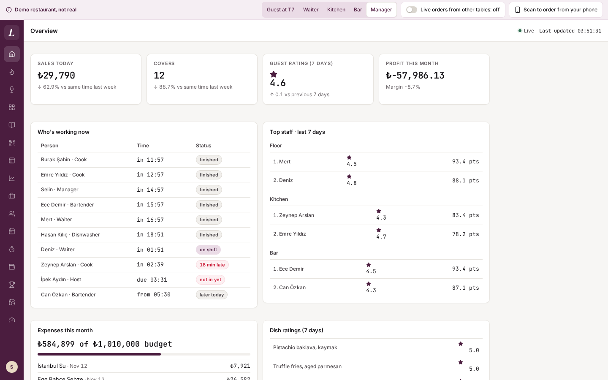
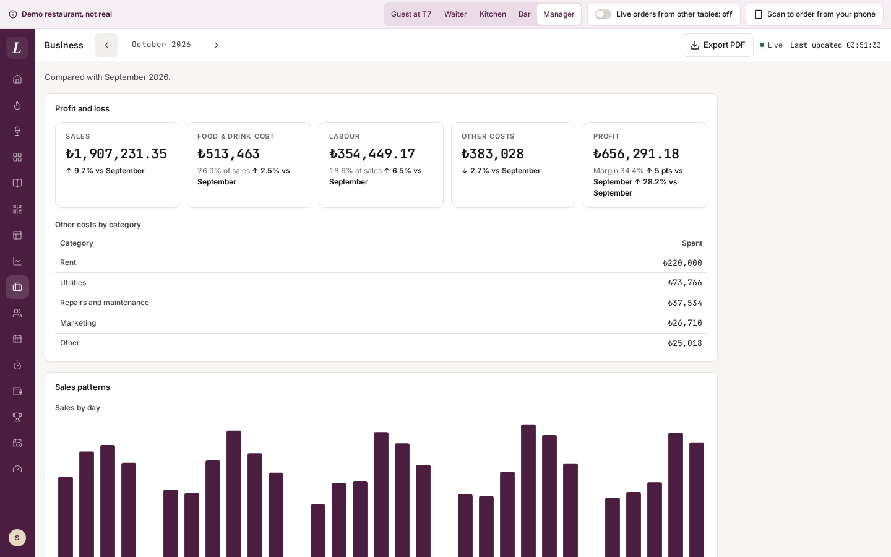
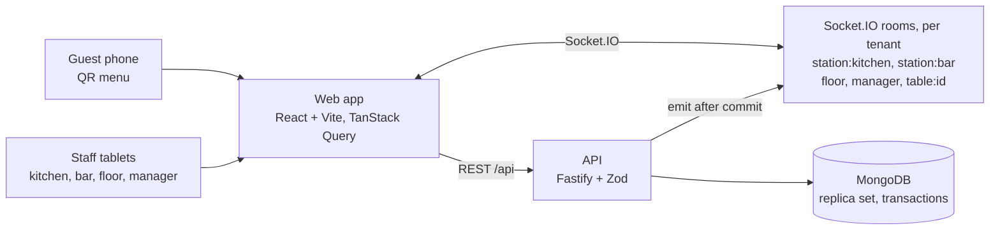

# Lodos

**A real-time restaurant system: QR ordering, kitchen and bar displays, a waiter's floor plan, split bills, sales, staff scheduling, guest ratings, a time clock and a monthly business dashboard, in English and Turkish.**

[](https://github.com/cemakcck/lodos/actions/workflows/ci.yml)
[](LICENSE)

**Live demo:** <https://lodos.cemakcicek.com> (launching soon) · **Portfolio:** <https://cemakcicek.com> · **GitHub:** [@cemakcck](https://github.com/cemakcck)

A guest scans the QR code on their table and orders. Within a second the dish is on the kitchen screen with a chime, the drink is on the bar's, and the waiter's floor plan knows. The hard part is the part you don't see: **an order is never lost and never doubled**, whether the guest's phone drops mid-order, two guests race for the last portion, or a waiter closes the check while an order is in flight.

Lodos is a portfolio project by [Cem Akçiçek](https://cemakcicek.com). The restaurant is **fictional** (a bistro and cocktail bar in Karaköy, Istanbul, named after the city's southwesterly wind): every dish, table, staff name and order is made up, and the app says "Demo restaurant, not real" on every screen.

<p>
  
  
</p>
<p>
  
  
  
</p>
<p>
  
  
</p>

## What it does

| Who | What they get |
| --- | --- |
| **Guest** | A QR menu per table: photos, allergens, dietary tags, options and extras, a note for the kitchen. "Your table" follows every line live (Sent, Preparing, Ready, Served). Call the waiter or ask for the bill. No account, no personal data. |
| **Kitchen / bar** | A live ticket board per station: timers that turn amber then red, tick items off, bump, hold, recall, "All day" counts, the 86 list, and a chime plus a screen-reader announcement for each new ticket. |
| **Waiter** | The floor plan with live table states (free, seated, food ready, calling, bill) and an attention queue. Seat a table, order from the tablet (food goes to the kitchen, drinks to the bar), close the check. |
| **Closing the check** | Pay in full, split evenly (2 to 20 shares) or by item, one payment per share (card or cash, simulated). **Comps and voids** need a reason and a manager's PIN typed on the waiter's tablet. An **80 mm receipt** with VAT (KDV) lines, per share or for the whole check. |
| **Manager** | Menu editor (items, options, allergens, photos, prices) and one-tap 86 with an optional "N left" count. **Sales** for today, 7 or 30 days (revenue, covers, ticket times by hour, top dishes, comps and voids) with **CSV export**. **Staff** management with PINs and table assignments. A weekly **shift** schedule with templates, working-hours warnings and **PDF** export. A drag-and-drop **floor plan editor** whose changes waiters see live. |
| **Ratings** | After a paid visit the guest's phone asks "How was your visit?": the waiter, each dish, and food, cleanliness and atmosphere, one to five stars plus an optional comment. One rating per check, within 24 hours of closing. |
| **Time clock and wages** | Staff punch in and out on a wall-screen time clock with their own PIN (`/staff/clock`, no sign-in needed). Late and missing people show up live, hours past 45 a week are paid at 1.5x, and every entry is priced at the hourly rate in force when it was clocked. Managers edit the timesheets and see the cost. |
| **Performance** | A 0 to 100 score and a ranking per group (waiters, kitchen, bar) from guest ratings, workload, on-time tickets and reliability, with a breakdown per person. Everyone sees their own score and rank position on **My performance**, and never anyone else's. |
| **Expenses and budgets** | Expenses by category with a monthly budget each, and a spent-versus-budget view that flags overspending. |
| **Overview and monthly dashboard** | The manager's landing page: today's sales and covers, the guest rating, who is working now, top staff, expenses against budget and the month's profit. The **monthly dashboard** adds profit and loss (sales minus food and drink, labour and other costs), sales patterns, menu quadrants (stars, hidden gems, fix, rethink), ratings, a staff table and expenses, with a **PDF** and **CSV** export. |

Every visitor to the demo gets **their own private copy** of the restaurant, seeded with a busy Friday service (late tickets, a table calling, a couple of 86'd dishes) and four months of history: sales, shifts and hours, guest ratings and expenses. Nobody else sees your changes, and the copy is deleted 30 minutes after your last window closes.

## Tech stack

- **Frontend:** React 19, Vite, TypeScript, Tailwind CSS, React Router, TanStack Query, i18next (English and Turkish), an installable PWA.
- **Backend:** Node 22, Fastify 5, Zod, Mongoose 9 on MongoDB 8 (replica set), Socket.IO, argon2, pdfkit.
- **Tests:** Vitest with Testing Library, mongodb-memory-server, Playwright with axe-core, GitHub Actions.
- **Repo:** npm workspaces: `apps/web`, `apps/api`, and `packages/shared` (the Zod schemas and the money and time helpers both sides use).



REST carries commands and reads; Socket.IO only says "something changed". After each committed write the API emits a small event to the rooms that care, and clients refetch. The server is the single source of truth, so a missed event costs a refetch, never data.

## Engineering highlights

- **Money is integer kuruş.** No floating point anywhere. Even and by-item splits use a largest-remainder allocation, so the shares always add up to the check exactly ([`packages/shared/src/split.ts`](packages/shared/src/split.ts)).
- **Transactions where it matters.** Placing an order writes the check, the order, one ticket per station and the "N left" counts in one MongoDB transaction. When two guests order the last portion at once, exactly one wins and the other is told it just sold out. A test fires both orders concurrently and checks this.
- **Idempotent ordering.** Each order carries a client-generated key with a unique index behind it, so a retry after a timeout returns the original order instead of placing a second one.
- **Optimistic concurrency.** The floor plan saves a whole room against its version, so a stale editor gets `409 version_conflict` instead of overwriting someone else's layout. Taking a payment sends the total the waiter saw, and a bill that changed in the meantime answers `409 amount_changed`.
- **Tenant isolation that fails closed.** Every document carries a `tenantId`, enforced by one Mongoose plugin ([`apps/api/src/db/tenancy.ts`](apps/api/src/db/tenancy.ts)) rather than by each query: a query without a tenant throws. Integration tests check that one sandbox can't read or change another's data over HTTP or sockets.
- **Reconnects lose nothing.** Every screen takes a full snapshot on connect and reconnect, then applies events. An end-to-end test takes the kitchen offline, places an order, and expects the ticket on the board within 5 seconds of reconnecting.
- **Accessibility.** In the end-to-end run, axe checks the guest menu, the staff screens and the manager screens against WCAG 2.2 A and AA, and allows zero serious or critical violations. Everything you can drag (shifts, tables) also works by keyboard and by tap.
- **Real-world details.** Times are Istanbul time and the service day runs 06:00 to 05:59, so a 01:00 order belongs to the night before. Staff sign in by PIN (hashed with argon2, with a five-minute lockout).

The longer write-up, with each race condition and how it is handled, is in [docs/ARCHITECTURE.md](docs/ARCHITECTURE.md).

## Run it locally

You need **Node 22** and npm. That's all: no Docker, no database to install, no accounts or secrets.

```bash
git clone https://github.com/cemakcck/lodos.git
cd lodos
npm install      # also fetches a MongoDB 8.0 binary for the in-memory database (once, about 200 MB on disk)
npm run dev      # API on http://localhost:4100, web app on http://localhost:5180
```

Open <http://localhost:5180> and pick a role. Without a `.env`, `npm run dev` starts a throwaway in-memory MongoDB replica set and runs in demo mode; its data is gone when you stop it with Ctrl-C.

**Try the magic moment:** choose **Guest at T7**, order the Levrek crudo and a Lodos Negroni, then follow the "Now open the kitchen screen" callout. The crudo lands on the kitchen board with a chime and the Negroni goes to the bar. Press **Bump**, switch to **Waiter** in the demo banner, and T7 shows "Food ready".

**Demo logins.** The demo's role buttons sign you in without a PIN. The staff sign-in screen (`/staff/login`) and the manager approval pad take these:

| Person | Role | PIN |
| --- | --- | --- |
| Selin | Manager (also approves comps and voids) | `9999` |
| Deniz | Waiter | `1111` |
| Mert | Waiter | `2222` |
| Kitchen | Kitchen display | `3333` |
| Bar | Bar display | `4444` |

**Data that survives a restart** (optional, needs Docker with Compose): `cp .env.example .env && npm run db:up`, then `npm run dev`. This runs MongoDB 8 in Docker on port 27018.

**Order from your phone:** the demo banner's "Scan to order from your phone" QR code needs your phone to reach your laptop. Start the web app with `npm run dev -w @lodos/web -- --host`, open it at your computer's network address (for example `http://192.168.1.20:5180`) and set `WEB_ORIGIN` to that address.

## Tests

```bash
npm run lint && npm run typecheck
npm test                          # 1010 unit and integration tests in one parallel Vitest run over all workspaces
npx playwright install chromium   # once, for the end-to-end tests
npm run test:e2e                  # 30 Playwright tests against a production build
```

- **Unit:** money, the service day, splits, order routing, timers, table states, the cart, and a check that the English and Turkish message files have the same keys. Screen tests render each screen with a fake socket.
- **Integration** (against a real in-memory MongoDB replica set, not mocks): the last-portion race, idempotency, the close-versus-order race, role checks on every endpoint, sandbox isolation over HTTP and sockets.
- **End-to-end:** the magic moment across four browser windows, an 86 reaching an open guest menu, a split bill paid by two guests, a comp approved with a manager's PIN, the shift PDF, a floor plan change seen live on a second device, the kitchen catching up after going offline, a guest's rating reaching the manager's overview and monthly dashboard with a clock-in showing on shift, and the accessibility scans (English and Turkish for the new screens). Each test runs in its own sandbox.

Tests pass at any hour: the integration tests inject "now", and the demo seed is relative to when each sandbox is created. CI ([`.github/workflows/ci.yml`](.github/workflows/ci.yml)) runs lint and typecheck, unit and integration tests, end-to-end tests and the build as parallel jobs on every push and pull request.

## Project structure

```
apps/
  api/           Fastify API, one folder per area (orders, checks, kds, floor, layout, sales, shifts, staff, demo, …)
    src/db/      Mongoose models and the tenancy plugin
    src/seed/    The fictional restaurant: menu, tables, staff, a live service and four months of history
    test/        Integration tests against an in-memory replica set
  web/           React app
    src/guest/   The QR menu
    src/staff/   Kitchen and bar displays, floor, order entry, close and split, manager screens
    src/i18n/    English and Turkish messages
packages/
  shared/        Zod schemas, money, splits, service-day and shift rules used by both apps
e2e/             Playwright specs
docs/            Architecture notes, deploy guide, design specs and mockups, screenshots
scripts/dev.mjs  `npm run dev`: the dev servers, plus the in-memory MongoDB when no .env is set
```

## Deploying

The `Dockerfile` builds one image in which the API also serves the web app, so the pages, `/api` and `/socket.io` share one origin. It needs a MongoDB replica set (MongoDB Atlas works) and an always-on Node process for the WebSocket connections and the demo's timers; `railway.json` sets it up on Railway. Environment variables, the Railway steps, reverse-proxy notes, and running a real restaurant with demo mode off are in [docs/DEPLOY.md](docs/DEPLOY.md).

## Known limits

- **One API instance.** Socket.IO rooms and the demo's timers live in one process. Scaling out needs the Socket.IO Redis adapter, which isn't built yet.
- **No indexes for very large tenants yet.** Sales and the CSV query checks by payment time and adjustments by service day without dedicated indexes. That is fine at demo scale; a busy real restaurant needs them first.
- **Two rules are check-then-write.** The shift overlap check and the "always one active manager" rule read, then write, without a transaction. Two simultaneous edits (two managers deactivating each other in the same instant, or two overlapping shifts saved at once) can slip through.
- **Touch drag is untested on real devices.** Dragging in the schedule and the floor plan is covered by tests with synthetic pointer events only. Keyboard and tap alternatives exist for both.
- **Payments are simulated**, and the receipt is an information slip, not a fiscal receipt (it says so on its face). There is no card terminal, e-Arşiv or printer integration.

## Credits and license

The code is under the [MIT License](LICENSE).

The menu photos are from Wikimedia Commons under CC BY, CC BY-SA and CC0 licences; each one's author, licence and source link are in [`apps/web/public/photos/CREDITS.md`](apps/web/public/photos/CREDITS.md), and the guest menu links to the same credits. The schedule PDFs embed the Inter font under the SIL Open Font License ([`apps/api/assets/fonts/OFL.txt`](apps/api/assets/fonts/OFL.txt)).
