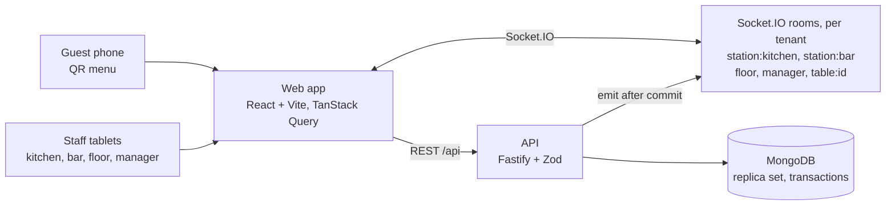

# Lodos architecture

The longer version of the README's overview: how the pieces talk, why the data lives in MongoDB, how an order survives flaky networks and races, how one visitor's sandbox is kept away from another's, and what each test layer covers.

## The shape of it

- **A separate React frontend and API**, in one npm workspaces repo: `apps/web` (React, Vite, Tailwind, React Router, TanStack Query, an installable PWA), `apps/api` (Fastify, Zod, Mongoose, Socket.IO) and `packages/shared` (the Zod schemas, money and service-day helpers both sides use).
- **REST for commands and reads, Socket.IO for "something changed".** After each committed change the API emits a small event (`ticket.created`, `check.updated`, `availability.changed`, …) to the rooms that care. Clients refetch the affected queries. The server is the single source of truth and events never carry the only copy of anything.
- **Rooms per audience and per tenant.** Kitchen screens join `<tenant>:station:kitchen`, waiters `<tenant>:floor`, a guest only `<tenant>:table:<id>`. Guest sockets authenticate with the table's QR token, staff sockets with the session cookie.
- **Staff sign in by PIN** on a shared tablet (name tiles, then a 4 to 6 digit pad). PINs are hashed with argon2, wrong attempts lock the person for 5 minutes, and kitchen and bar wall screens use station accounts that never log out mid-service.
- **Times are Istanbul time** and the "service day" runs from 06:00 to 05:59, so a 01:00 order belongs to the previous evening. Money is integer kuruş, VAT included, formatted in one shared helper.

## Why MongoDB here

The records are naturally documents:

- **A menu item carries its option groups** ("Gin: London dry / Barrel-aged +₺90 / Mastic +₺60") nested inside it, in two languages.
- **An order is a snapshot.** Each line stores the dish name, price and chosen options as they were when ordered, so a later menu edit never changes a past check. In a relational schema that is a set of copy tables; here it is the order document.
- **Tickets, calls and checks are small documents** that change state quickly, and a single-node replica set gives multi-document transactions for the few writes that must be atomic.

## How no order is ever missed

### 1. Snapshot on every reconnect

Every screen fetches a full snapshot of what it shows on connect and on every reconnect, then applies events. A kitchen tablet that drops off the wifi shows "Offline / Reconnecting…" within a second (the socket follows the browser's offline and online events instead of waiting for a heartbeat), and the moment it is back it refetches and the missed tickets appear, with the chime. A browser that never fires "online" still reconnects: the socket retries within 10 seconds, and at once when the screen is shown or focused. As a last backstop, the kitchen board refetches every 30 seconds while its socket is down, and "Last updated" moves with every snapshot. The `kds-reconnect` end-to-end test takes the kitchen offline, places an order, checks it is absent while offline, and expects it on the board within 5 seconds of reconnecting, without a page reload.

### 2. Idempotency keys

Placing an order carries a client-generated idempotency key. A retry after a timeout reuses the key; any edit to the cart makes a new one. A unique index on `(tenantId, idempotencyKey)` means a repeated request returns the existing order instead of creating a second one, even when both copies arrive at the same moment (`orders.idempotency.test.ts`).

### 3. The last portion is atomic

"N left" lives in a per-service-day availability document. Placing an order decrements it with a conditional update inside the order's transaction, so the whole order (check, order, tickets, decrements) commits or nothing does. When two guests order the last ribeye at once, the second writer gets a write conflict, the transaction retries on a fresh snapshot, sees the dish sold out, and the guest gets a clear "just sold out" with the rest of their cart kept. `orders.race.test.ts` fires the two orders concurrently: exactly one 201, one `sold_out`, and the loser leaves no trace.

### 4. A closed check accepts no orders

An order writes the check it lands on (`$inc orderCount`, conditional on the check still being open). A waiter closing the check at the same moment writes the same document, so the two transactions conflict and one is retried. A retried guest order then finds the visit over: it either opens the next party's check or, if the guest's page still belongs to the old visit, gets `check_closed` and the page says "This table's visit has ended". The close in turn re-reads the lines when it retries, so the amount charged always includes every order that committed (`checks.test.ts`, including a free-running test of concurrent orders and closes).

## Multi-tenancy: a sandbox per visitor

Every document carries a `tenantId`: the visitor's sandbox in demo mode, or the real restaurant's when demo mode is off. Scoping is enforced in **one Mongoose plugin** ([`apps/api/src/db/tenancy.ts`](../apps/api/src/db/tenancy.ts)), not per query by hand:

- A request runs inside `runWithTenant(id, …)` (AsyncLocalStorage). Every find, update, delete, aggregate, insert and bulk write on a scoped model is filtered by, or stamped with, that tenant.
- It **fails closed.** A query with no tenant context throws. Writing a different `tenantId` throws. Aggregation stages a filter can't scope (`$lookup`, `$unionWith`, `$out`) throw. The rare global lookup (a QR token, the sandbox registry) uses `unscoped(reason, …)` with the reason written at the call site.
- Socket rooms are namespaced per tenant too. The integration tests prove one sandbox can never read or change another's data, over HTTP (`isolation-http.test.ts`) or sockets (`isolation-socket.test.ts`).

Sandboxes are tied to the browser by a signed, httpOnly cookie, capped at 200 live copies (the oldest idle one goes first), rate-limited per IP, and cleaned up by a job every few minutes.

## Management data: rollups and one reader

Phase 3 adds ratings, a time clock, wages, expenses and the dashboards over them. Two decisions keep the numbers consistent:

- **Raw documents for the recent past, generated aggregates for the rest.** Guest `Rating` and staff `ClockEntry` documents are the source of truth for recent days (ratings for the last 14 days, clock entries for the last 35 in the demo seed). Older days exist only as generated aggregates on `DailySummary`: `ratings` (per waiter, per dish and per restaurant category, with a star distribution), `people` (minutes, overtime, labour cost, late shifts, station tickets) and `byServer`. A day never has both, so nothing is counted twice, and summaries stored before the feature read the new fields as empty.
- **One reader, `opsForDays`** ([`apps/api/src/ops/daily.ts`](../apps/api/src/ops/daily.ts)). Given service days it returns each day's ratings, per-person figures and ticket times, merging the stored aggregate with whatever raw documents the day has. The overview, the monthly dashboard, the performance rankings, and My performance read through it, so a seeded day and a live day look the same to every screen and a rollup can be regenerated without touching a dashboard.
- **One P&L function** ([`apps/api/src/business/pnl.ts`](../apps/api/src/business/pnl.ts)). Profit is sales minus food and drink cost, labour and other costs, in integer kuruş, and the overview and the monthly page (and so its PDF and CSV) both call it, so the figures reconcile to the kuruş. Labour prices each clock entry at the hourly rate in force at its clock-in, plus a 0.5x premium for hours past 45 in a Monday to Sunday week.
- **Privacy at the API.** Hourly rates and other people's performance are manager-only endpoints; `/api/me/performance` returns only the caller's own figures, and the rank as `{ position, of }` with no names. The time clock needs no session, so its PIN check is rate-limited and locks out like the staff sign-in.

## What the tests cover

- **Unit:** money, the service day, timer thresholds, table-state precedence, order routing (one ticket per station), the cart and order-entry drafts, price parsing, and a check that the English and Turkish message files have identical keys. Screen tests render each screen with a fake socket, including server-time timers with the device clock a year off.
- **Integration** (against an in-memory MongoDB replica set, not mocks): order placement, the last-portion race, idempotency, closed-check rejection and the close/order race, token scoping, role checks on every endpoint, sandbox isolation over HTTP and sockets, and sandbox cleanup.
- **End-to-end** (Chromium, each test in its own fresh sandbox):
  - **the magic moment** with two browser windows: the guest orders, the kitchen sees the ticket within 2 seconds of the order and the bar sees only the drink; a bump shows T7 as "Food ready" on the floor within 2 seconds
  - an 86 from the manager reaching an open guest menu within 2 seconds, with no reload
  - a waiter order sending food to the kitchen and drinks to the bar, and the check grouped as Food and Drinks with the right subtotals
  - closing a check: the table turns free, the guest's page says the visit ended, and the next order opens a new visit
  - the kitchen catching up after going offline
  - the kitchen ticket headers reading on one line at 1280 px with four columns (the README's kitchen screenshot)
  - phase 3: a guest rates a paid visit on their phone, and the rating shows on the manager's overview and the monthly dashboard's latest comments while a waiter's clock-in appears as on shift
  - phase 2: a check split by item and paid by two guests with their receipts, a comp approved with a manager's PIN, the Sales dashboard, a Dinner shift added from a template with the week PDF downloaded (the file starts with `%PDF`), and a floor-plan move saved by the manager that a waiter on a second device sees without reloading
- **Accessibility:** axe checks the guest menu, the dish sheet, "Your table", the staff login, the kitchen, the floor with a table selected, order entry, the close view in each mode, the approval pad and the receipt, the menu editor, Sales, Staff, Schedule, My shifts, the floor plan editor with a table selected and the demo landing, and (in English and Turkish) the overview, the monthly dashboard, performance, expenses, timesheets, My performance, the time clock and the guest rating card against WCAG 2.2 A and AA, and allows zero serious or critical violations, with no rule disabled. What it found and we fixed: buttons whose spoken name left out their visible text (the EN/TR toggle said "English" but showed "EN", and the floor plan editor's SVG tables read "T7" and "4" as "T74"), an amber that was 4.35:1 instead of 4.5:1, and a scrolling check panel a keyboard couldn't reach.
- **Wall-clock independence:** tests pass at any hour. The integration tests inject "now"; the end-to-end seed is relative to the moment each sandbox is created and no test asserts a clock time.

## Design documents

The specs and implementation plans the project was built from are in [`docs/superpowers/specs`](superpowers/specs) and [`docs/superpowers/plans`](superpowers/plans), and the approved visual mockups in [`docs/design-reference`](design-reference) (open them in a browser).
